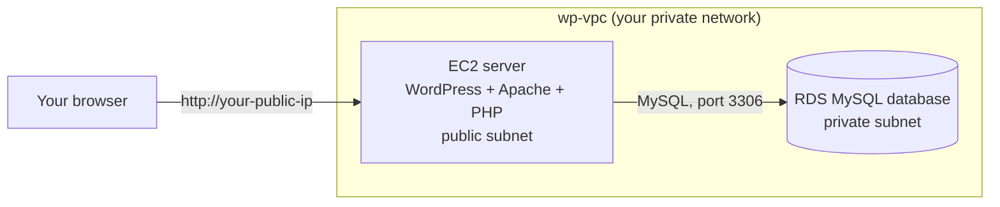

# WordPress on AWS Workshop

**Session 2: WordPress Integration on AWS** · November 14, 2026 

No AWS experience needed. You'll put a real WordPress site on Amazon Web Services: the site runs on a cloud server (**EC2**), and its posts are saved in a cloud database (**RDS**). It's the hands-on version of this morning's hosting talk: today, you are the host.



## How this lab works

Most of the lab is clicking. You'll **copy-paste one script** and **type two short commands**. That's all the "coding" there is.

- **Bold text** = a button or option to click.
- `Gray text` = something to type, paste, or pick from a list.
- If you fall behind, raise your hand; a helper will come to you.
- Your AWS sandbox is free and temporary. You can't break anything or get charged, and it's deleted after the event.

## AWS words in plain language

| AWS word | What it means |
| --- | --- |
| AWS Console | The website where you control AWS |
| Region (Singapore) | Which AWS data center your things live in |
| EC2 | A computer you rent in the cloud; it runs your website |
| RDS | A database that AWS runs and maintains for you; it stores your posts |
| VPC | Your own private network inside AWS |
| Security group | A firewall: a list of who is allowed to connect |
| Public IP | Your server's address on the internet |
| Endpoint | Your database's address |

## Before the event

Do this at home **by November 12**:

1. Find the email from AWS titled **Invitation to join AWS IAM Identity Center** (check spam).
2. Click **Accept invitation** and create a password.
3. If asked for MFA, choose **Authenticator app** and scan the QR code with Google Authenticator or Microsoft Authenticator on your phone.
4. Bookmark the portal link from the email.

On event day, **during lunch (around 12:15 PM)**, open the portal and log in once to check it works. If it doesn't, tell a helper before 12:45.

Bring a laptop (not a phone or tablet), its charger, and the phone with your authenticator app.

---

## Step 1: Log in

1. Open your bookmarked portal link (it ends in `.awsapps.com/start`) and sign in.
2. Click the one AWS account you see, then click **WorkshopParticipant**. The AWS Console opens.
3. Top right of the page: check that it says **Asia Pacific (Singapore)**. If not, click it and choose **Asia Pacific (Singapore)**.
4. Open a notepad app. You'll save three things during the lab:

| Save this | You get it in | Write it here |
| --- | --- | --- |
| Server public IP | Step 3 | |
| Database password | Step 4 (you make it up) | |
| Database endpoint | Step 5 | |

---

## Step 2: Create your network (VPC)

A VPC is your own private network in AWS. The "VPC and more" option builds everything in one click: the network, public subnets for your server, private subnets for your database, and the route to the internet.

1. Click the search bar at the top, type `VPC`, and click **VPC**.
2. Click **Create VPC** (orange button).
3. Change **only** these settings:

| Setting | Choose or type |
| --- | --- |
| Resources to create | **VPC and more** |
| Name tag auto-generation | Keep **Auto-generate** checked, and type `wp` |
| IPv4 CIDR block | Leave as `10.0.0.0/16` |
| Number of Availability Zones (AZs) | **2** |
| Number of public subnets | **2** |
| Number of private subnets | **2** |
| NAT gateways | **None** (important: other options are blocked in the sandbox) |
| VPC endpoints | **None** (important: change it from S3 Gateway) |

4. Look at the **Preview** on the right: it shows your network as a diagram. Then click **Create VPC**.
5. Wait until every line shows a green check (about 1 minute), then click **View VPC**.

**Checkpoint:** you have a VPC named `wp-vpc`.

---

## Step 3: Launch your server

You'll rent a small cloud computer and give it a script that installs WordPress by itself.

1. Click the search bar at the top, type `EC2`, and click **EC2**.
2. Click **Launch instance** (orange button).
3. Change **only** these settings:

| Section on the page | Setting | Choose or type |
| --- | --- | --- |
| Name and tags | Name | `wp-server` |
| Application and OS Images | | Leave as **Amazon Linux 2023** |
| Instance type | | `t3.micro` |
| Key pair (login) | Key pair name | **Proceed without a key pair** (that's fine; you'll connect through the browser) |
| Network settings | | Click **Edit** first, then set the rows below |
| Network settings | VPC | `wp-vpc` |
| Network settings | Subnet | The one with **public1** in its name |
| Network settings | Auto-assign public IP | **Enable** |
| Network settings | Firewall (security groups) | **Create security group** |
| Network settings | Security group name | `wp-web-sg` |
| Network settings | Inbound rule 1 | Type **ssh**, Source type **Anywhere** |
| Network settings | Click **Add security group rule** → Inbound rule 2 | Type **HTTP**, Source type **Anywhere** |
| Advanced details (at the very bottom; click to expand) | User data (the last box) | Paste the script below |

**Paste this into User data.** Click the copy button on the box, then click inside the User data box and press **Ctrl+V** (**Cmd+V** on Mac). The same script is also in [`scripts/user-data.sh`](scripts/user-data.sh).

```bash
#!/bin/bash
# Installs the web server, PHP, and WordPress automatically
dnf update -y
dnf install -y httpd php php-fpm php-mysqlnd php-json php-gd php-mbstring php-xml php-intl wget mariadb105
systemctl enable --now httpd php-fpm
cd /tmp && wget -q https://wordpress.org/latest.tar.gz && tar -xzf latest.tar.gz
cp -r wordpress/* /var/www/html/
cp /var/www/html/wp-config-sample.php /var/www/html/wp-config.php
sed -i "s/database_name_here/wordpress/; s/username_here/admin/" /var/www/html/wp-config.php
chown -R apache:apache /var/www/html

# Helper command 1: connect WordPress to your RDS database
cat > /usr/bin/connect-db << 'EOF'
#!/bin/bash
read -p "Paste your RDS endpoint, then press Enter: " DB_HOST
read -s -p "Type your database password, then press Enter (it stays hidden): " DB_PASS
echo
echo "Testing the connection to your database..."
if mysql -h "$DB_HOST" -u admin -p"$DB_PASS" -e "CREATE DATABASE IF NOT EXISTS wordpress;" 2>/tmp/db-error.txt; then
  sed -i "s/password_here/$DB_PASS/; s/'localhost'/'$DB_HOST'/" /var/www/html/wp-config.php
  echo "SUCCESS! WordPress is connected to RDS. Go back to your browser and refresh."
else
  echo "NOT CONNECTED. Check your endpoint and password, then run: sudo connect-db"
  cat /tmp/db-error.txt
fi
EOF

# Helper command 2: show the posts stored in RDS
cat > /usr/bin/show-posts << 'EOF'
#!/bin/bash
H=$(grep "'DB_HOST'" /var/www/html/wp-config.php | cut -d"'" -f4)
P=$(grep "'DB_PASSWORD'" /var/www/html/wp-config.php | cut -d"'" -f4)
mysql -h "$H" -u admin -p"$P" wordpress -e "SELECT ID, post_title AS 'Posts stored in RDS' FROM wp_posts WHERE post_status='publish';"
EOF
chmod +x /usr/bin/connect-db /usr/bin/show-posts
```

4. Click **Launch instance** on the right. Click it only **once**.
5. Click **View all instances**. When **Instance state** says **Running**, click `wp-server` and copy the **Public IPv4 address** into your notepad.

**Checkpoint:** `wp-server` is **Running** and you saved its public IP.

---

## Step 4: Create your database

Now you'll create the database and tell AWS to connect it to your server. AWS sets up the firewall between them for you.

1. Click the search bar at the top, type `RDS`, and click **Aurora and RDS**.
2. Click **Create database** (orange button).
3. Go down the page and change **only** these settings. Leave everything else as it is.

| Section on the page | Setting | Choose or type |
| --- | --- | --- |
| Choose a database creation method | | **Standard create** (or **Full configuration**) |
| Engine options | Engine type | **MySQL** |
| Templates | | **Free tier** (or **Dev/Test** if no Free tier) |
| Availability and durability | | **Single-AZ DB instance** |
| Settings | DB instance identifier | `wp-db` |
| Settings | Master username | `admin` |
| Settings | Credentials management | **Self managed** |
| Settings | Master password and Confirm | Make one up: **letters and numbers only**, 8+ characters. Save it in your notepad. |
| Instance configuration | DB instance class | **Burstable classes**, then `db.t3.micro` |
| Storage | Allocated storage | `20` |
| Storage → Additional storage configuration | Enable storage autoscaling | **Uncheck** it |
| Connectivity | Compute resource | **Connect to an EC2 compute resource** |
| Connectivity | EC2 instance | `wp-server` |
| Connectivity | Everything else (VPC, subnet group, public access, security group) | Leave as AWS fills it in |
| Additional configuration (near the bottom) | Initial database name | `wordpress` |
| Additional configuration | Enable deletion protection | **Unchecked** |

4. Click **Create database** at the bottom. If a pop-up appears, click **Close**.

**Checkpoint:** you see `wp-db` with status **Creating**. It takes about 15 minutes; the next step is what to do while you wait.

---

## Step 5: Wait and learn

Your database is being built and your server is installing WordPress. Listen to the speaker explain what you just built, then do these two quick checks.

1. **Check your server.** In a new browser tab, type `http://` followed by your public IP, for example `http://13.250.10.20`. You should see the message **Error establishing a database connection**. That's good news: WordPress is installed, it just isn't connected to the database yet. If the page is blank or shows a test page, wait 2 minutes and refresh.
2. **Get your database address.** Go back to the AWS Console. Search `RDS`, open **Databases**, and wait until `wp-db` says **Available** (click the refresh icon). Click `wp-db`. Under **Connectivity & security**, copy the **Endpoint** (it ends in `.rds.amazonaws.com`) into your notepad.

**Checkpoint:** you see the database error page, and your notepad has the endpoint.

---

## Step 6: Connect WordPress to your database

1. In the AWS Console, go to **EC2 → Instances** and click `wp-server`.
2. Click **Connect** (top of the page). Choose the **EC2 Instance Connect** tab and click **Connect**. A black window with text opens in a new tab. This is your server's terminal.
3. Type this command exactly and press Enter:

```bash
sudo connect-db
```

4. When asked, paste your **endpoint** and press Enter. (To paste in this window, right-click → **Paste**, or press **Ctrl+Shift+V**.)
5. When asked, type your **database password** and press Enter. Nothing appears while you type; that's normal.

**Checkpoint:** the terminal says **SUCCESS! WordPress is connected to RDS.** If it says NOT CONNECTED, run `sudo connect-db` again and check for typos. If it fails twice, raise your hand.

---

## Step 7: Set up your WordPress site

This part works just like this morning's WordPress workshop.

1. Go back to your browser tab with `http://<your public IP>` and refresh. The WordPress setup screen appears.
2. Choose **English** and click **Continue**.
3. Fill in a Site Title (anything you like), a Username (not `admin`), a Password (save it), and your Email.
4. Click **Install WordPress**, then **Log In**.
5. Go to **Posts → Add New Post**. Title it `Hello from AWS`, type a sentence, and click **Publish**.
6. Visit `http://<your public IP>` to see your post live on the internet. Share the link with the person next to you.

### Prove your post is saved in the RDS database

Go back to the black terminal window, type this, and press Enter:

```bash
sudo show-posts
```

**Checkpoint:** a small table appears with your `Hello from AWS` post. Your website runs on EC2, and your posts are stored in RDS. You just hosted WordPress on AWS.

If the terminal window closed, open it again from **EC2 → Instances → wp-server → Connect**.

---

## Step 8: Wrap-up

You don't need to delete anything; your sandbox is cleaned up automatically after the event. The speaker will show how to delete resources so you know what to do in your own AWS account in the future.

Please don't stop or restart your server during the session: its address would change and your site would break.

---

## If something goes wrong

| What you see | What to do |
| --- | --- |
| Can't log in to the portal | Raise your hand. Don't create a personal AWS account. |
| "Access denied" or "not authorized" | Check the top right says **Singapore**, and that you picked `t3.micro` / `db.t3.micro` exactly. |
| VPC creation fails on a NAT gateway or endpoint | NAT gateways and VPC endpoints must both be **None**. Raise your hand; a helper will help you delete and redo it. |
| `wp-vpc` isn't in the list when launching the server | Check the Region is **Singapore** and that Step 2 finished with all green checks. |
| `wp-server` isn't in the list when creating the database | Make sure the server was launched in Step 3 and the Region is Singapore. Click the refresh icon next to the list. |
| Website page won't open | Make sure you typed `http://` (not `https://`), and that `wp-web-sg` has the HTTP rule. Wait 2 minutes and refresh. |
| Still a test page after 10 minutes | The script may not have been pasted. Raise your hand; a helper will relaunch your server. |
| `connect-db: command not found` | Same as above: the script wasn't pasted. Raise your hand. |
| EC2 Instance Connect won't open | Check `wp-web-sg` has the ssh rule from **Anywhere**. Wait 1 minute after the server shows Running and try again. |
| NOT CONNECTED from `sudo connect-db` | Check the database says **Available**, then run it again with the exact endpoint and password. If it still fails, the database may not be connected to `wp-server`; raise your hand. |
| Database error page after SUCCESS | Refresh the page once or twice. Still there? Raise your hand. |

Stuck for more than 5 minutes? Raise your hand. A helper can move you to a fresh sandbox so you can catch up.

---

## Doing this in your own AWS account later

You can repeat this exact lab in a personal AWS account, but you'll pay for what you run. When you're done, delete in this order: the RDS database `wp-db` (no final snapshot), the EC2 server `wp-server`, then the VPC `wp-vpc` (deleting the VPC also removes its subnets and security groups).

Organized by the **AWS Student Builder Group – APC** with **JPCS**.
